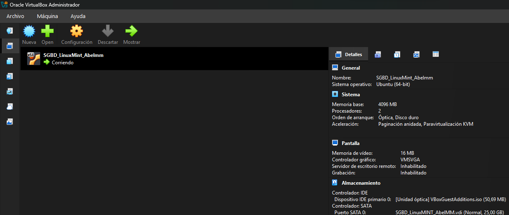
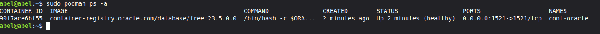
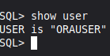
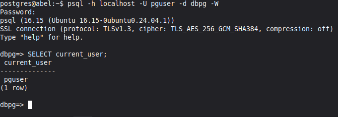
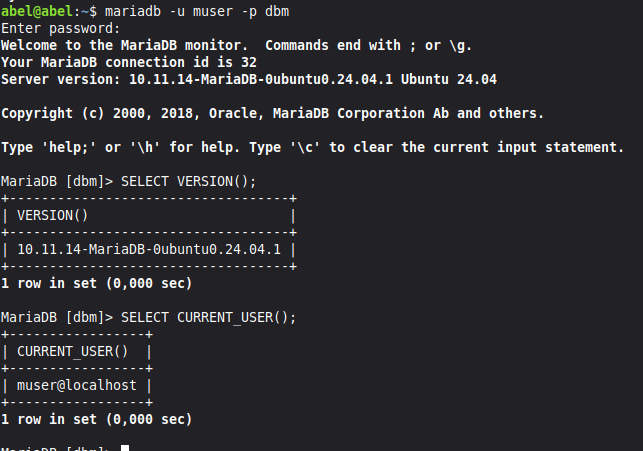
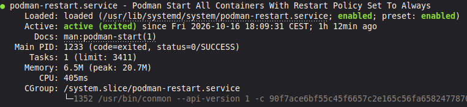
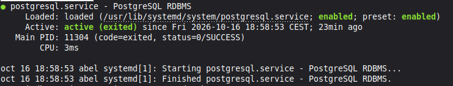
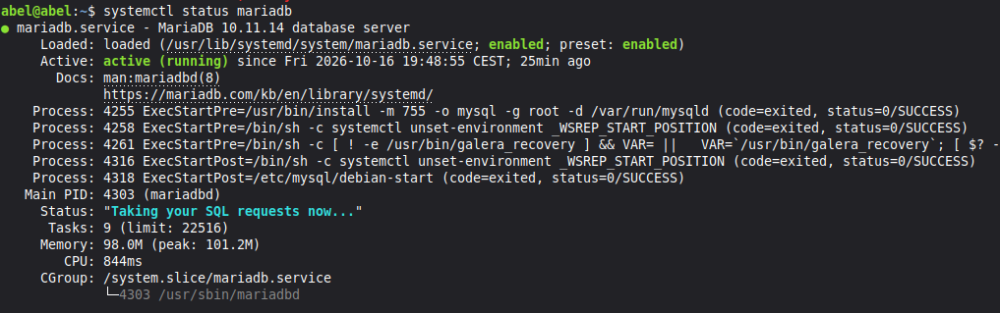
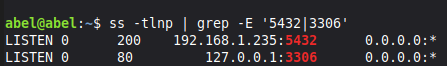
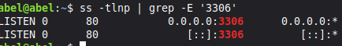

# Práctica: instalar tres SGBD

Abel · 16/10/2026

Esta práctica consiste en instalar Oracle 23ai Free, PostgreSQL y MariaDB en una misma máquina virtual, crear una base de datos y un usuario en cada uno y comprobar que se puede entrar. Lo hice siguiendo el orden del enunciado.

** Para la máquina virtual.** Usé VirtualBox con una VM llamada `SGBD_LinuxMint_Abelmm`, un Linux Mint de 64 bits con 4 GB de RAM y 2 procesadores. El disco VDI empezó en 25 GB y lo tuve que ampliar a 50 GB. La red está en NAT y la IP de la VM es <IP>.



*Configuración de la VM en VirtualBox.*

**Versiones instaladas:**

| SGBD | Versión | Cómo lo comprobé |
|---|---|---|
| Oracle Database 23ai Free | 23.5.0.0 | `sudo podman images` |
| PostgreSQL | 16.15 | `psql --version` |
| MariaDB | 15.1 | `mariadb --version` |

## 1. Oracle Database 23ai Free con Podman

Primero instalé Podman y bajé la imagen de Oracle:

```bash
sudo apt update
sudo apt install podman
sudo podman pull container-registry.oracle.com/database/free:23.5.0.0
sudo podman images
```

Después creé el volumen con nombre, para que los datos no se pierdan si se borra el contenedor, y lancé el contenedor publicando el puerto 1521:

```bash
sudo podman volume create oracle_23ai_datos
sudo podman run -d --name cont-oracle -p 1521:1521 --restart=always -v oracle_23ai_datos:/opt/oracle/oradata:U container-registry.oracle.com/database/free:23.5.0.0
sudo podman ps
sudo podman ps -a
sudo podman logs cont-oracle
```

Tardó un rato en arrancar. Fui repitiendo `podman ps` hasta que salió *healthy*, y en los logs apareció `DATABASE IS READY TO USE!`.



*`podman ps` con el contenedor ya sano.*

Como no puse `ORACLE_PWD`, la imagen generó una contraseña de administración. La miré en los logs y luego la cambié por una mía.

Para crear el usuario entré como sysdba y trabajé dentro de la PDB `FREEPDB1`:

```bash
sudo podman exec -it cont-oracle sqlplus / as sysdba
```

```sql
SHOW PDBS
ALTER SESSION SET CONTAINER = FREEPDB1;
CREATE USER orauser IDENTIFIED BY "<clave>";
GRANT CREATE SESSION, CREATE TABLE TO orauser;
ALTER USER orauser QUOTA 100M ON USERS;
EXIT
```

Y comprobé que `orauser` podía entrar:

```bash
sudo podman exec -it cont-oracle sqlplus orauser@//localhost:1521/FREEPDB1
```

Una vez dentro ejecuté `SHOW USER` para confirmar con qué usuario estaba conectado.



*Sesión abierta en `FREEPDB1`; `SHOW USER` devuelve `ORAUSER`.*

## 2. PostgreSQL

```bash
sudo apt update
sudo apt install postgresql postgresql-contrib php-pgsql
sudo systemctl start postgresql
sudo systemctl enable postgresql
sudo -i -u postgres
psql
```

Ya en `psql` creé la base y el usuario:

```sql
CREATE DATABASE dbpg;
CREATE USER pguser WITH PASSWORD '<clave>';
GRANT ALL PRIVILEGES ON DATABASE dbpg TO pguser;
\q
```

Salí del usuario `postgres` con `exit` y probé a entrar con `pguser`:

```bash
psql -h localhost -U pguser -d dbpg -W
```



*Conectado como `pguser` a `dbpg`; con `SELECT version();` sale la versión.*

## 3. MariaDB

```bash
sudo apt update
sudo apt install mariadb-server mariadb-client
sudo systemctl enable --now mariadb
sudo mariadb
```

Dentro de MariaDB:
```sql
CREATE DATABASE dbm CHARACTER SET utf8mb4 COLLATE utf8mb4_unicode_ci;
CREATE USER 'muser'@'localhost' IDENTIFIED BY '<clave>';
GRANT ALL PRIVILEGES ON dbm.* TO 'muser'@'localhost';
FLUSH PRIVILEGES;
EXIT;
```

Y probé a entrar con `muser`:

```bash
mariadb -u muser -p dbm
```



*Conectado como `muser` a `dbm`; con `SELECT VERSION();` sale la versión.*

## 4. Resumen y comprobaciones

| SGBD | IP | Base/servicio | Puerto | Usuario | Contraseña |
|---|---|---|---|---|---|
| Oracle 23ai Free | localhost | FREEPDB1 | 1521 | orauser | la elegida por mí |
| PostgreSQL | localhost | dbpg | 5432 | pguser | la elegida por mí |
| MariaDB | localhost | dbm | 3306 | muser | la elegida por mí |

Para ver el estado de los servicios usé `systemctl status` con `podman-restart.service` (el que recupera el contenedor de Oracle al reiniciar la VM), `postgresql` y `mariadb`. Los tres salieron <active>.





*Estado de los tres servicios.*

## 5. Conexiones desde otra máquina

La red la cambié a adaptador puente para poder conectar desde otra máquina, y la IP de la VM es 192.168.1.235.

**PostgreSQL.** En `postgresql.conf` (`/etc/postgresql/16/main/`) descomenté `listen_addresses` y le puse la IP de la VM, porque por defecto solo escucha en localhost:

En `pg_hba.conf` añadí una regla limitada a la base, al usuario y a mi red:
host dbpg pguser 192.168.1.0/24 scram-sha-256


Reinicié con `sudo systemctl restart postgresql`.



*<PostgreSQL escuchando en 192.168.1.235:5432>*

**MariaDB.** En `/etc/mysql/mariadb.conf.d/50-server.cnf`, dentro de `[mysqld]`, cambié el `bind-address` a la IP de la VM:
bind-address = 192.168.1.235

Además de `'muser'@'localhost'`, creé una cuenta para la IP del cliente con permisos solo sobre `dbm`:

```sql
CREATE USER 'muser'@'<IP_CLIENTE>' IDENTIFIED BY '<clave>';
GRANT ALL PRIVILEGES ON dbm.* TO 'muser'@'<IP_CLIENTE>';
FLUSH PRIVILEGES;
```

Reinicié con `sudo systemctl restart mariadb`.



*<MariaDB escuchando en 192.168.1.235:3306 o la conexión desde otra máquina.>*

**Cortafuegos.** <"UFW estaba inactivo, así que no hizo falta abrir puertos.">
<Si estaba activo:>

```bash
sudo ufw allow from 192.168.1.0/24 to any port 5432 proto tcp
sudo ufw allow from <IP_CLIENTE> to any port 3306 proto tcp
```


## 6. Problemas, fuentes y entrega

**Problemas que tuve**

El primero fue de espacio. Al hacer el `podman pull` de Oracle me salió:
Error: copying system image from manifest list: writing blob: ... processing tar file(write /opt/oracle/oradata/FREE/system01.dbf: no space left on device): exit status 1

El disco de 25 GB se quedó corto. Apagué la VM, amplié el VDI a 50 GB con `VBoxManage modifymedium disk ... --resize 51200` y, como Linux no veía el espacio nuevo, extendí la partición `/dev/sda3` con `growpart` y `resize2fs`. Limpié lo que quedó a medias con `sudo podman system prune -a` y repetí la descarga, que ya terminó bien.

El segundo fue un `ORA-01017` al conectar. Había escrito `CONNECT ORAUSER` sin indicar el servicio, así que entraba en la base raíz, donde ese usuario no existe. Conectando con `orauser@//localhost:1521/FREEPDB1` ya entró.

**Fuentes**

- [Oracle Database Free, guía oficial](https://www.oracle.com/es/database/free/get-started/)
- Enunciado de la práctica


